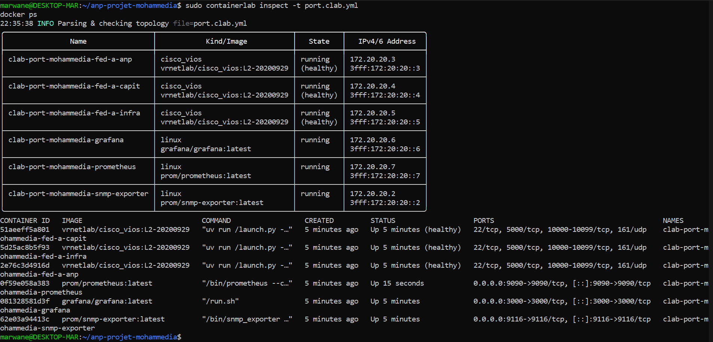
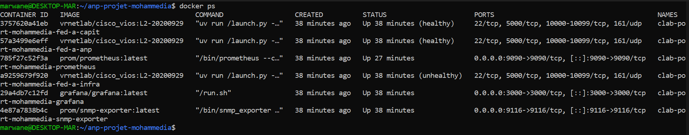
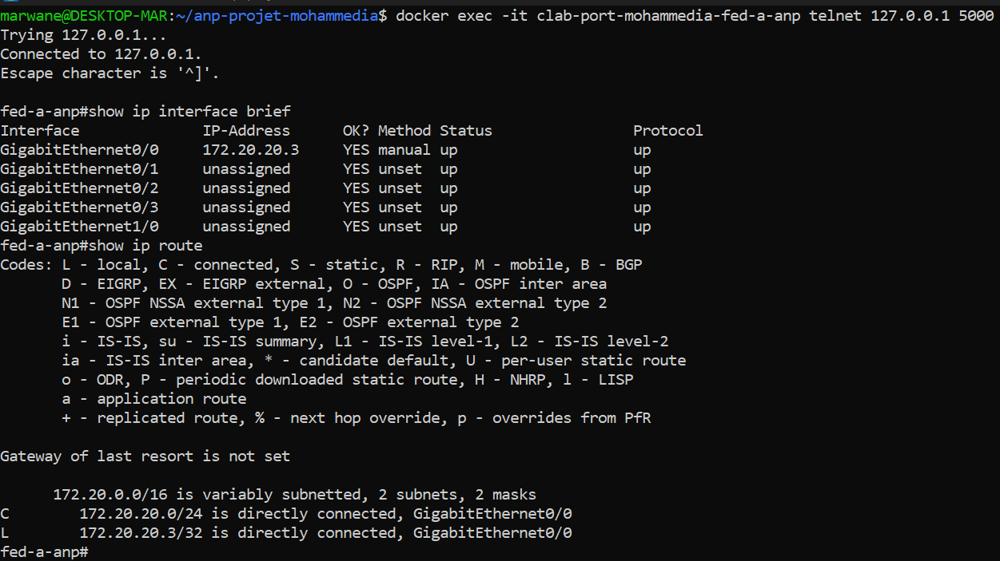
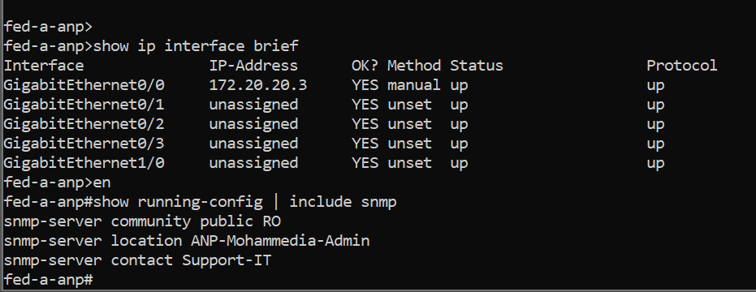
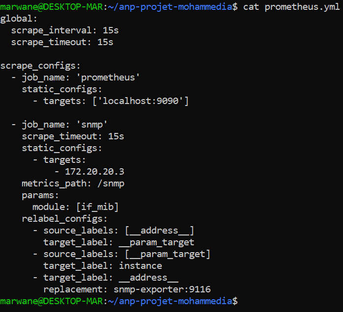
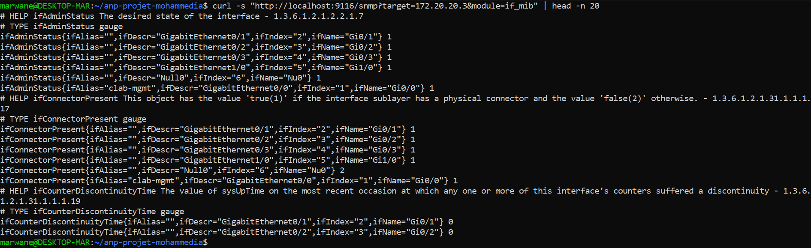
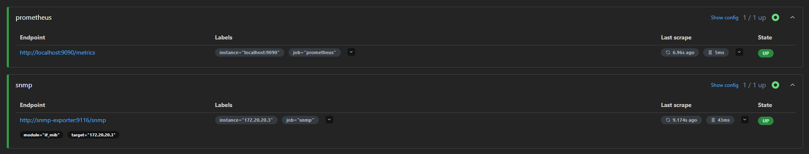
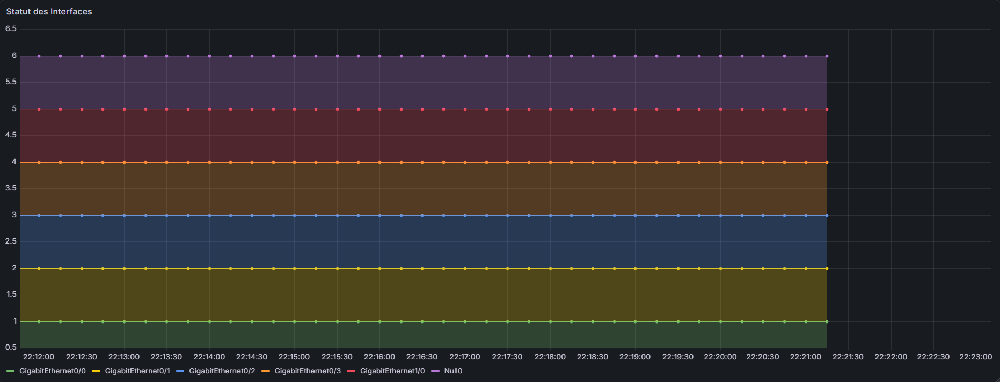
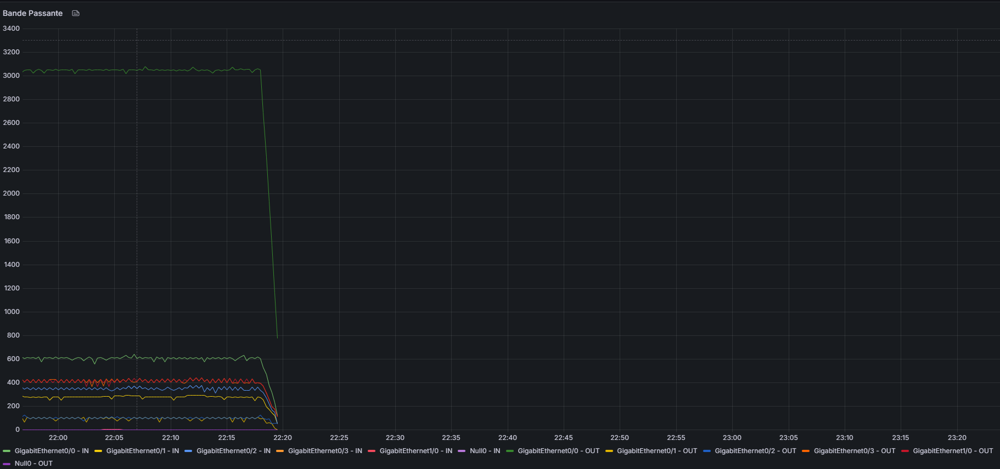

# 📡 Supervision réseau — ANP Port de Mohammedia

### Stage à l'Agence Nationale des Ports · Port de Mohammedia

**Supervision d'un switch Cisco vIOS avec SNMP, Prometheus et Grafana**


> « Un réseau qui fonctionne, on n'y pense pas. Un réseau qui tombe, tout le monde le remarque. »

---

## 🎯 Présentation

Ce projet met en place une chaîne de supervision complète pour un switch Cisco vIOS. L'objectif est simple : **voir en temps réel l'état des interfaces et le trafic**, conserver un historique des mesures et disposer de graphiques lisibles pour diagnostiquer une panne rapidement.

Le laboratoire reproduit trois switches du Port de Mohammedia :

| Switch | Site | Rôle |
|---|---|---|
| `fed-a-anp` | Bâtiment Administratif | Switch central, cible SNMP principale |
| `fed-a-capit` | Capitainerie | Switch du site, prêt à être supervisé |
| `fed-a-infra` | Phares & Balises | Switch du site, prêt à être supervisé |

La supervision repose sur trois briques complémentaires :

- **`snmp-exporter`** interroge le switch en SNMP et transforme les réponses en métriques HTTP lisibles par Prometheus.
- **Prometheus** collecte ces métriques toutes les **15 secondes** et les stocke dans une base de séries temporelles.
- **Grafana** interroge Prometheus en PromQL et affiche deux dashboards : **Statut des Interfaces** et **Bande Passante**.

SNMP a été choisi parce qu'il est natif sur les équipements Cisco, ne nécessite aucun agent à installer et permet une lecture seule, sans impact sur la configuration du switch.

---

## 🏗️ Architecture

```text
                    ┌──────────────────────────────┐
                    │    Poste d'administration     │
                    │  navigateur :3000  /  :9090   │
                    └───────────────┬──────────────┘
                                    │
                    ┌───────────────┴───────────────┐
                    │                               │
           ┌────────▼────────┐             ┌────────▼────────┐
           │     Grafana     │    PromQL   │   Prometheus    │
           │      :3000      │◄────────────│      :9090      │
           └─────────────────┘             └────────┬────────┘
                                                    │ scrape /snmp
                                                    │ toutes les 15 s
                                          ┌─────────▼─────────┐
                                          │   snmp-exporter   │
                                          │       :9116       │
                                          └─────────┬─────────┘
                                                    │ SNMP v2c
                                                    │ UDP/161
                                          ┌─────────▼─────────┐
                                          │   Cisco vIOS      │
                                          │    fed-a-anp      │
                                          │   172.20.20.3     │
                                          └───────────────────┘
```

### Flux réseau

| Source | Destination | Protocole | Port |
|---|---|---|---|
| Prometheus | `snmp-exporter` | HTTP | `9116/tcp` |
| `snmp-exporter` | `fed-a-anp` | SNMP v2c | `161/udp` |
| Navigateur | Prometheus | HTTP | `9090/tcp` |
| Navigateur | Grafana | HTTP | `3000/tcp` |
| Administrateur | Console vIOS | Telnet | `5000/tcp` |

> `fed-a-capit` (`172.20.20.4`) et `fed-a-infra` (`172.20.20.5`) sont également déployés. Pour les superviser, il suffit d'ajouter leur adresse dans le job `snmp` de `prometheus.yml`.

---

## 🗺️ Plan d'adressage IP

Réseau de management du lab : **`172.20.20.0/24`**

| Équipement | Rôle | Adresse IP | Ports exposés |
|---|---|---|---|
| `snmp-exporter` | Traduction SNMP → Prometheus | `172.20.20.2` | `9116/tcp` |
| `fed-a-anp` | Switch central — Bâtiment Administratif | `172.20.20.3` | `22`, `5000`, `161/udp` |
| `fed-a-capit` | Switch — Capitainerie | `172.20.20.4` | `22`, `5000`, `161/udp` |
| `fed-a-infra` | Switch — Phares & Balises | `172.20.20.5` | `22`, `5000`, `161/udp` |
| `grafana` | Dashboards et visualisation | `172.20.20.6` | `3000/tcp` |
| `prometheus` | Collecte et stockage des métriques | `172.20.20.7` | `9090/tcp` |

Les adresses de management sont attribuées par Containerlab via la directive `mgmt-ipv4`. L'interface `GigabitEthernet0/0` du switch récupère automatiquement `172.20.20.3`.

---

## 🚀 Déploiement pas à pas

### 1. Prérequis

- **Docker** et **Containerlab** installés (Linux ou WSL2).
- L'image **`vrnetlab/cisco_vios:L2-20200929`**, construite localement à partir d'une image Cisco vIOS sous licence. Elle n'est pas distribuée publiquement.
- Environ **8 Go de RAM** disponibles pour faire tourner les six conteneurs confortablement.

### 2. Cloner le dépôt et déployer le lab

```bash
git clone https://github.com/marwane5h/anp-projet-n-2-port-mohammedia.git
cd anp-projet-mohammedia

# Vérifier que l'image vIOS est disponible
docker images | grep cisco_vios

# Déployer la topologie
sudo containerlab deploy -t port.clab.yml
```

### 3. Vérifier que tout tourne

```bash
sudo containerlab inspect -t port.clab.yml
docker ps
```

Résultat attendu : **six conteneurs en `running`**, dont les trois switches vIOS en `healthy`, et les ports `9090`, `3000` et `9116` exposés sur la machine hôte.

### 4. Configurer le switch en SNMP

Connexion à la console du switch :

```bash
docker exec -it clab-port-mohammedia-fed-a-anp telnet 127.0.0.1 5000
```

Puis, dans IOS :

```cisco
enable
configure terminal
snmp-server community public RO
snmp-server location ANP-Mohammedia-Admin
snmp-server contact Support-IT
end
write memory
```

Vérification :

```cisco
show running-config | include snmp
show ip interface brief
```

> ⚠️ La communauté `public` en lecture seule est utilisée **uniquement pour le lab**. En production, passez à SNMPv3 avec `authPriv` et restreignez l'accès par ACL (voir la section [Sécurité](#-sécurité)).

### 5. Tester l'exportateur SNMP

```bash
curl -s "http://localhost:9116/snmp?target=172.20.20.3&module=if_mib" | head -n 20
```

La réponse doit contenir des métriques comme `ifAdminStatus`, `ifOperStatus`, `ifDescr` ou `ifInOctets`.

### 6. Vérifier les cibles Prometheus

Ouvrir [http://localhost:9090/targets](http://localhost:9090/targets).

Les deux jobs doivent être **`UP`** :

- `prometheus` → `http://localhost:9090/metrics`
- `snmp` → `http://snmp-exporter:9116/snmp?module=if_mib&target=172.20.20.3`

Si le job `snmp` est `DOWN`, vérifier dans l'ordre : le conteneur `snmp-exporter`, la joignabilité de `172.20.20.3`, puis la communauté SNMP.

### 7. Ouvrir Grafana

Ouvrir [http://localhost:3000](http://localhost:3000) et se connecter avec `admin` / `admin` (Grafana demande de changer le mot de passe à la première connexion).

Ajouter la source de données Prometheus :

```text
URL : http://prometheus:9090
```

Si le nom DNS ne résout pas depuis Grafana, utiliser l'adresse de management : `http://172.20.20.7:9090`.

Créer ensuite les deux dashboards décrits dans la section [Requêtes PromQL](#-requêtes-promql).

### 8. Arrêter le lab

```bash
sudo containerlab destroy -t port.clab.yml
```

Ajouter `--cleanup` pour supprimer également le dossier de travail du lab.

---

## 📊 Requêtes PromQL

Les deux dashboards Grafana s'appuient sur trois requêtes principales.

| Dashboard | Panneau | Requête | Unité |
|---|---|---|---|
| Statut des Interfaces | État par interface | `ifOperStatus{instance="172.20.20.3", job="snmp"}` | code SNMP |
| Bande Passante | Trafic entrant | `rate(ifInOctets{instance="172.20.20.3", job="snmp"}[5m]) * 8 / 1000` | Kbit/s |
| Bande Passante | Trafic sortant | `rate(ifOutOctets{instance="172.20.20.3", job="snmp"}[5m]) * 8 / 1000` | Kbit/s |

```promql
# Statut des interfaces
ifOperStatus{instance="172.20.20.3", job="snmp"}

# Débit entrant (Kbit/s)
rate(ifInOctets{instance="172.20.20.3", job="snmp"}[5m]) * 8 / 1000

# Débit sortant (Kbit/s)
rate(ifOutOctets{instance="172.20.20.3", job="snmp"}[5m]) * 8 / 1000
```

**Légende Grafana :** `{{ifDescr}}` pour afficher le nom de chaque interface.

**Lecture du statut `ifOperStatus` :** `1` = up, `2` = down, `3` = testing, `4` = unknown, `5` = dormant, `6` = notPresent, `7` = lowerLayerDown.

> Pour les liens Gigabit et au-delà, préférez les compteurs 64 bits `ifHCInOctets` et `ifHCOutOctets` : ils évitent le débordement des compteurs 32 bits sur les débits élevés.

---

## 🖼️ Aperçu du lab

<table>
  <tr>
    <td width="50%" align="center">
      
      <br><sub><b>Figure 1</b> — Le lab vu par <code>containerlab inspect</code> : six conteneurs, trois switches vIOS et la stack de supervision.</sub>
    </td>
    <td width="50%" align="center">
      
      <br><sub><b>Figure 2</b> — <code>docker ps</code> confirme que les six conteneurs tournent, avec les ports 9090, 3000 et 9116 exposés.</sub>
    </td>
  </tr>
  <tr>
    <td width="50%" align="center">
      
      <br><sub><b>Figure 3</b> — État des interfaces et table de routage du switch <code>fed-a-anp</code>.</sub>
    </td>
    <td width="50%" align="center">
      
      <br><sub><b>Figure 4</b> — Configuration SNMP du switch : communauté <code>public</code> en lecture seule, localisation et contact.</sub>
    </td>
  </tr>
  <tr>
    <td width="50%" align="center">
      
      <br><sub><b>Figure 5</b> — Le fichier <code>prometheus.yml</code> : deux jobs, <code>prometheus</code> et <code>snmp</code>, avec le module <code>if_mib</code>.</sub>
    </td>
    <td width="50%" align="center">
      
      <br><sub><b>Figure 6</b> — Les métriques SNMP brutes renvoyées par <code>snmp-exporter</code> sur le port 9116.</sub>
    </td>
  </tr>
  <tr>
    <td width="50%" align="center">
      
      <br><sub><b>Figure 7</b> — Les deux cibles Prometheus sont <code>UP</code>, dont la cible SNMP <code>172.20.20.3</code>.</sub>
    </td>
    <td width="50%" align="center">
      
      <br><sub><b>Figure 8</b> — Dashboard « Statut des Interfaces » : une ligne par interface, avec le code <code>ifOperStatus</code>.</sub>
    </td>
  </tr>
  <tr>
    <td colspan="2" align="center">
      
      <br><sub><b>Figure 9</b> — Dashboard « Bande Passante » : trafic entrant et sortant par interface.</sub>
    </td>
  </tr>
</table>

---

## 📄 Rapport complet

Le rapport de stage détaille la préparation du lab, la configuration du switch, la collecte SNMP, la construction des dashboards et le bilan du projet.

**[📥 Télécharger le rapport PDF complet](docs/Rapport_Supervision_ANP_Mohammedia.pdf)**

---

## 🔐 Sécurité

Ce laboratoire utilise la communauté SNMP `public` en lecture seule pour rester simple et reproductible. **Ce n'est pas une configuration de production.**

Avant tout déploiement réel :

- passer à **SNMPv3** avec `authPriv` (authentification et chiffrement) ;
- restreindre l'accès SNMP par **ACL** au seul serveur de supervision ;
- ne jamais exposer les ports `161`, `9090`, `3000` ou `9116` sur Internet ;
- changer le mot de passe Grafana par défaut et activer HTTPS ;
- segmenter le réseau de management du réseau de production.

---

## 📁 Structure du dépôt

```text
anp-projet-mohammedia/
├── docs/
│   └── Rapport_Supervision_ANP_Mohammedia.pdf
├── screenshots/
│   ├── bande_passante.png
│   ├── cisco_config.png
│   ├── cisco_interfaces.png
│   ├── docker_ps.png
│   ├── inspect.png
│   ├── prometheus_targets.png
│   ├── prometheus_yml.png
│   ├── snmp_metrics.png
│   └── status_interfaces.png
├── .gitignore
├── port.clab.yml
├── prometheus.yml
└── README.md
```

---

## 👤 Auteur

**Marwane Hamouyat**  
Stage — Agence Nationale des Ports (ANP), Port de Mohammedia  
Octobre 2026

> Projet réalisé dans un laboratoire virtuel. Les configurations, adresses et captures présentées sont celles du lab ; toute reproduction sur un réseau réel doit être adaptée et sécurisée.
